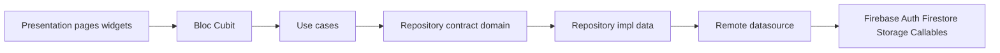

# BASMA Architecture Audit (Stage A)

**Date:** 2026-11-16  
**Tree:** `unify/basma-v1` (documented HEAD `bb0a905` + preserved dirty worktree)  
**Scope:** Discovery only — no code changes.  
**Evidence policy:** Verified facts | Measured results | Inferred risks | Recommendations | Unresolved questions

---

## 1. Verified facts

### 1.1 Organization

- Feature-first Clean Architecture is the accepted ADR ([ARCHITECTURE_DECISIONS.md](../../ARCHITECTURE_DECISIONS.md) ADR-001).
- `lib/features/` contains **29** feature folders: `accounts`, `admin`, `analytics`, `app_update`, `assistant`, `audio_library`, `auth`, `awards`, `calendar`, `chat`, `complaints`, `content`, `directory`, `halaqa_activity`, `halaqa_plan`, `homework`, `mushaf`, `notifications`, `onboarding`, `parent`, `post`, `progress_report`, `review_schedule`, `schedule`, `staff`, `student`, `student_search`, `supervisor`, `teacher`.
- `lib/core/`: `constants`, `di`, `error`, `firebase`, `network`, `presentation`, `router`, `session`, `usecases`.
- Cross-cutting UI/domain under `lib/shared/`.
- Backend: Cloud Functions under `functions/src` (Master Register: **64** active exports — 52 callables, 11 triggers, 1 scheduled — on current R1 inventory).
- Flutter test Dart files under `test/`: **282** counted this audit pass.

### 1.2 Flavor / Firebase routing (verified from source)

| Flavor | Project | Emulator |
|--------|---------|----------|
| `dev` / `staging` | `demo-rafiq-rules` only | Required (`USE_FIREBASE_EMULATOR=true`), debug-only |
| `trial` | `rafiq-academy` | Forbidden |
| `prod` | Not configured | Refuses to start |

Source: [lib/core/firebase/app_flavor.dart](../../lib/core/firebase/app_flavor.dart).

### 1.3 Typical layer chain (roles)

Examples with present layers:

| Feature | Presentation | Domain | Data |
|---------|--------------|--------|------|
| auth | pages + bloc | usecases | datasources |
| chat | pages + bloc | usecases + repo contract | repo impl + remote datasource |
| admin | pages + blocs | usecases (ops) | admin remote + operations datasources |
| parent / teacher / student / supervisor | pages + blocs | usecases / repos | remote datasources |
| homework / schedule / notifications | pages + domain | present | remote datasources |

### 1.4 Routing

- Central routes in [lib/core/router/app_routes.dart](../../lib/core/router/app_routes.dart) + [router_app.dart](../../lib/core/router/router_app.dart).
- Public self-registration route retained only to redirect to login (D1 / WA-1 comment in `AppRoutes`).
- Role homes: `/admin`, `/supervisor`, `/teacher`, `/parent`, `/student` (and assistant cover paths).
- Mushaf student routes exist; **protected Quran content not opened** this audit (BASMA-018).

### 1.5 DI (measured from generated GetIt config)

- Pattern: `@InjectableInit` → `injection_container.config.dart`.
- Counts in generated `init()`: **231** `lazySingleton`, **9** `singleton`, **33** `factory` (inventory agent [Architecture inventory](a257f375-c599-4d2f-99f1-89561c220b39)).
- Largest buckets: admin (42 lazy), teacher (16), supervisor (15), chat (15), parent (14), mushaf (12 — not opened).
- **No generated DI** for: `accounts`, `assistant`, `complaints`, `directory`, `onboarding`, `staff` — screens construct repos with `sl<FirebaseFirestore>()` / Functions (**Confirmed** layer skip).

### 1.6 Cross-cutting ownership

- **No** `lib/features/payments` — payments live across admin/parent/supervisor + `lib/shared`.
- Meeting links live in `lib/shared` (+ student join helpers), not a standalone feature folder.

---

## 2. Measured results

- Feature folder count: 29.
- Flutter `test/**/*.dart` files: 282.
- GetIt registrations: 231 lazy + 9 singleton + 33 factory.
- Trial APK on device proved end-to-end Auth→role home for six roles against live `rafiq-academy` ([_backups/ACADEMY_TRIAL_RUNTIME_DIAGNOSIS.md](../../_backups/ACADEMY_TRIAL_RUNTIME_DIAGNOSIS.md)).

---

## 3. Clean Architecture leaks (strongest Confirmed samples)

Domain folders under features/shared: **no** direct `cloud_firestore` / `firebase_auth` imports found (good).

| # | Location | Problem |
|---|----------|---------|
| 1 | `admin/domain/admin_reports.dart` | Domain imports data repo + presentation currency label |
| 2 | `admin_halaqa_details_page.dart` | Page queries Firestore directly |
| 3 | `admin_broadcast_page.dart` | Page runs Firestore `count()` |
| 4 | `admin_settings_tab.dart` | Password change via `FirebaseAuth` in UI |
| 5 | `admin_account_access_card.dart` | Widget → Firestore + Functions |
| 6 | `first_login_page.dart` | Page bypasses AuthBloc for account callable path |
| 7 | `admin_directory_page.dart` | No bloc/usecase; builds Firestore directory repo in widget |
| 8 | `complaints_entry.dart` | Manual wiring; not in generated DI |
| 9 | `chat_room.dart` / `chat_groups_provider.dart` | Presentation builds Storage/Functions repos |
| 10 | `audio_bloc.dart` | Bloc depends on FirebaseAuth + data services |

Also: role gate is **path-prefix** (`isAllowed`), not per-route ACL — any new page under `/admin` inherits admin access (**Potential Risk** for future routes).

| Finding | Taxonomy | Evidence | Impact |
|---------|----------|----------|--------|
| Layer skips (complaints/directory/accounts) | Confirmed Issue | No B/U in DI | Divergent AuthZ/error mapping |
| Shared payments ownership | Potential Risk | No single feature owner | Cross-role regression risk |
| Shared widgets vs per-role scaffolds | Existing Known Issue (AUD-041/042) | Master matrix | Inconsistent UX |
| Mushaf feature present | Blocked Verification | BASMA-018 | Not audited |

---

## 4. Recommendations (Stage D candidates — not executed)

1. Keep feature-first; avoid cross-feature business logic (ADR-001/002).
2. Before refactors, map all consumers of shared widgets and admin payment helpers.
3. Treat callables as the write authority boundary; do not “fix” cloud Trial by client writes.

---

## 5. Unresolved questions

- Exact DI registration count and circular dependency graph — needs automated tool or full di_module parse.
- Whether all 29 features are reachable from router (orphan check partially covered historically in FINAL_ORPHAN audit — re-verify in Integration report).
